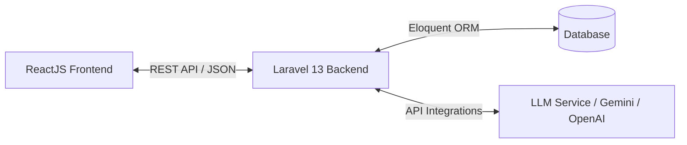

# AI Chatbot Project Documentation

Welcome to the **AI Chatbot** project documentation. This project is built using a decoupled architecture with a Laravel 13 backend, a ReactJS frontend, and this dedicated documentation folder.

## Project Structure

```text
AI-Chatbot/
├── backend/             # Laravel 13 API Backend
├── frontend/            # ReactJS + Vite Frontend
└── docs/                # Project Documentation
```

---

## Getting Started

### Prerequisites

To run this project locally, ensure you have the following installed on your system:
- **PHP 8.2+** (PHP 8.5.4 detected on this system)
- **Composer** (Composer 2.9.5 detected)
- **Node.js & NPM** (Node v22.19.0 & NPM 10.9.3 detected)
- **MySQL / SQLite** (XAMPP MySQL or SQLite can be used)

---

## Setup Instructions

### 1. Backend Setup (Laravel 13)

1. Navigate to the backend directory:
   ```bash
   cd backend
   ```
2. Install dependencies (if not already done):
   ```bash
   composer install
   ```
3. Copy the environment file and configure your database:
   ```bash
   cp .env.example .env
   ```
4. Generate the application key:
   ```bash
   php artisan key:generate
   ```
5. Install API routing and Sanctum:
   ```bash
   php artisan install:api
   ```
6. Run the database migrations:
   ```bash
   php artisan migrate
   ```
7. Start the Laravel development server:
   ```bash
   php artisan serve
   ```
   The backend will be running at `http://127.0.0.1:8000`.

### 2. Frontend Setup (ReactJS + Vite)

1. Navigate to the frontend directory:
   ```bash
   cd frontend
   ```
2. Install npm dependencies:
   ```bash
   npm install
   ```
3. Start the Vite development server:
   ```bash
   npm run dev
   ```
   The frontend will be running at `http://localhost:5173`.

---

## System Architecture

The AI Chatbot application operates on a decoupled client-server model:



1. **Frontend (ReactJS + Vite)**: Communicates with the backend using Axios/Fetch. Handles UI rendering, user input, streaming responses, and chat history visualization.
2. **Backend (Laravel 13)**: Acts as a stateless RESTful API. Handles authentication (Laravel Sanctum), stores chat history in the database, and communicates with AI models (such as Gemini, OpenAI, or local models).
3. **Database**: Stores user accounts, chat sessions, and individual messages.
