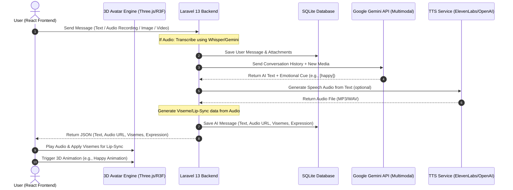
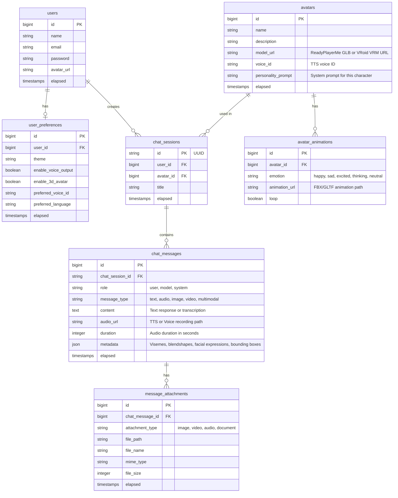

# Advanced 3D Multimodal AI Chatbot Database Design

This document details the database schema and system architecture for an advanced, real-time multimodal AI Chatbot. The system supports:
- **Multimodal Inputs/Outputs**: Text, Audio (voice messages), Images, and Videos.
- **Real-Time Voice Chat**: Speech-to-Text (STT) transcription and Text-to-Speech (TTS) audio generation.
- **3D Avatar Integration**: Support for Ready Player Me (.glb) and VRoid Studio (.vrm) models, including emotional animations and lip-sync (viseme) metadata.

---

## 1. System Architecture Flow



---

## 2. Database Schema (Entity-Relationship Diagram)



---

## 3. Data Details & Advanced Fields

### `chat_messages.metadata` (JSON)
This field is critical for driving the 3D avatar on the frontend. It contains:
1. **`expression`**: Emotional cue parsed from the AI response (e.g. `happy`, `sad`, `thinking`, `surprised`).
2. **`visemes`**: Array of time-stamped mouth shape blendshapes (visemes) for lip-sync.
   ```json
   {
     "expression": "happy",
     "visemes": [
       {"time": 0, "viseme": "sil"},
       {"time": 100, "viseme": "PP"},
       {"time": 250, "viseme": "FF"},
       {"time": 400, "viseme": "O"}
     ]
   }
   ```

### `avatars.model_url`
Contains the absolute URL of the 3D model:
- **Ready Player Me**: Directly loads the `.glb` file using Three.js GLTFLoader.
- **VRoid Studio**: Loads the `.vrm` file using `@pixiv/three-vrm`.

### `message_attachments.file_path`
Stores files uploaded by the user (images of herbal leaves, videos of symptoms, voice recordings) in Laravel's local/S3 storage. These are sent as multimodal parts to the Gemini API.
