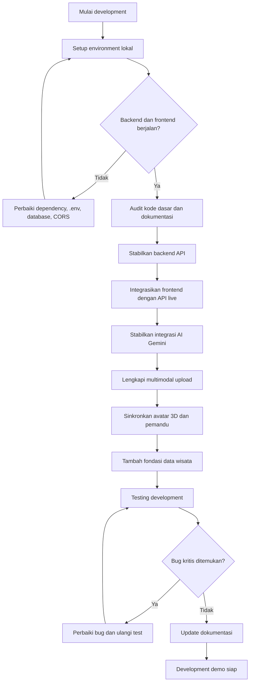
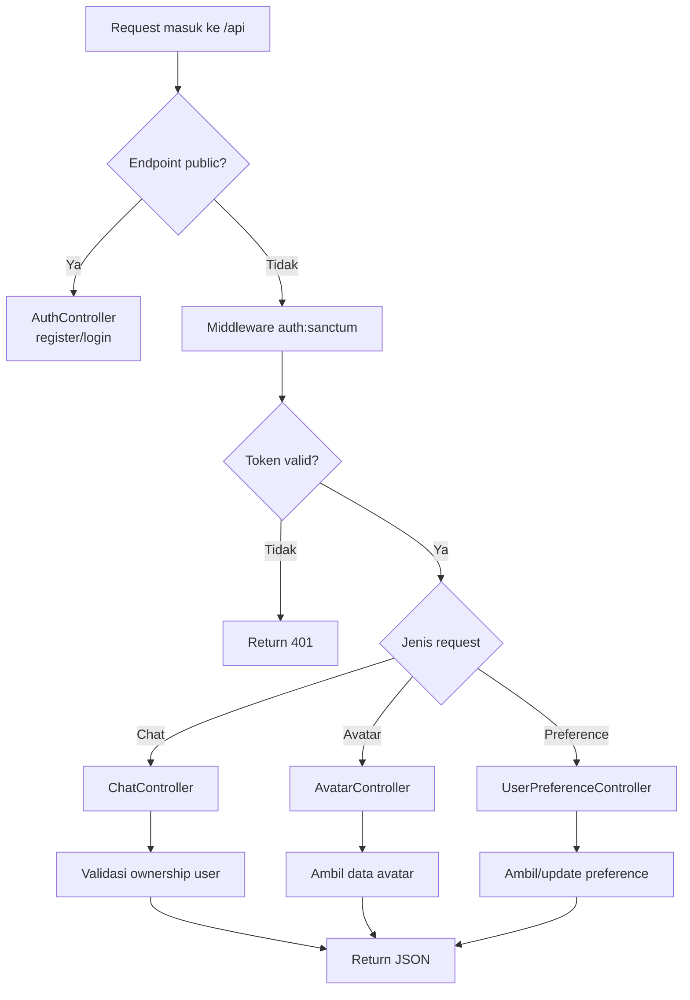
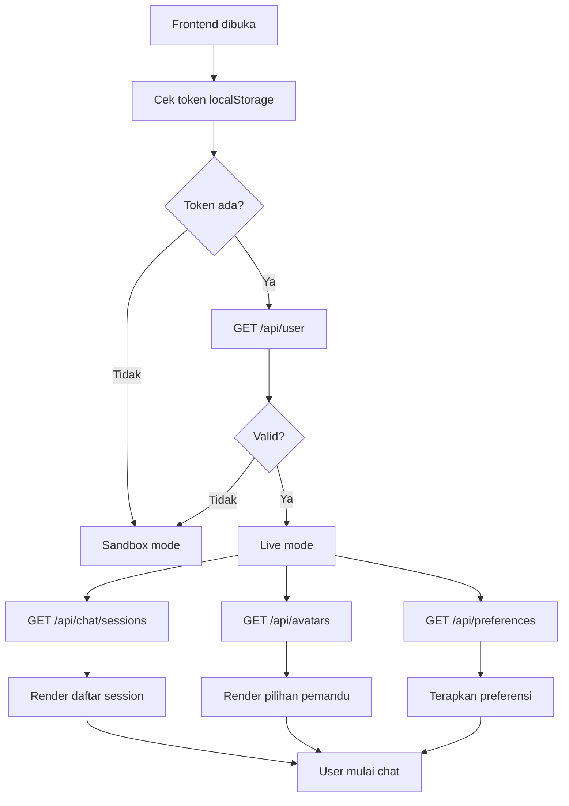
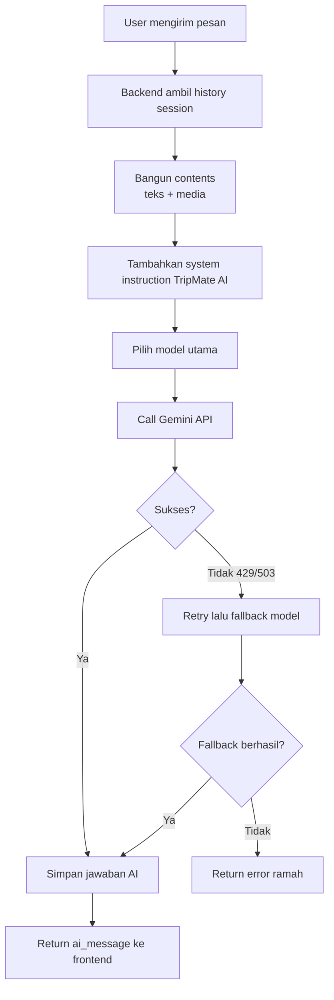
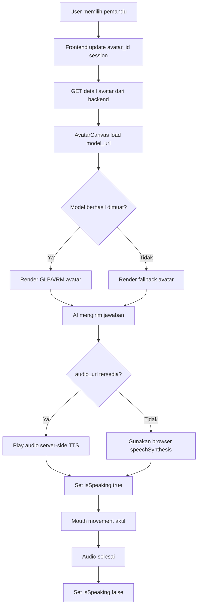
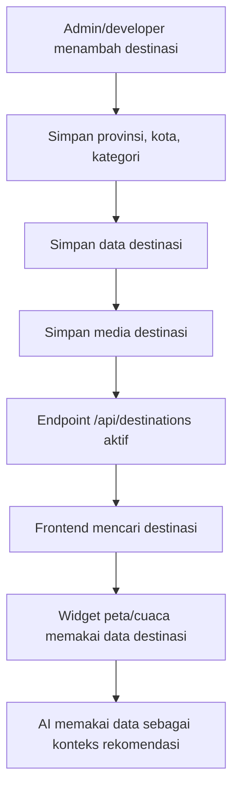
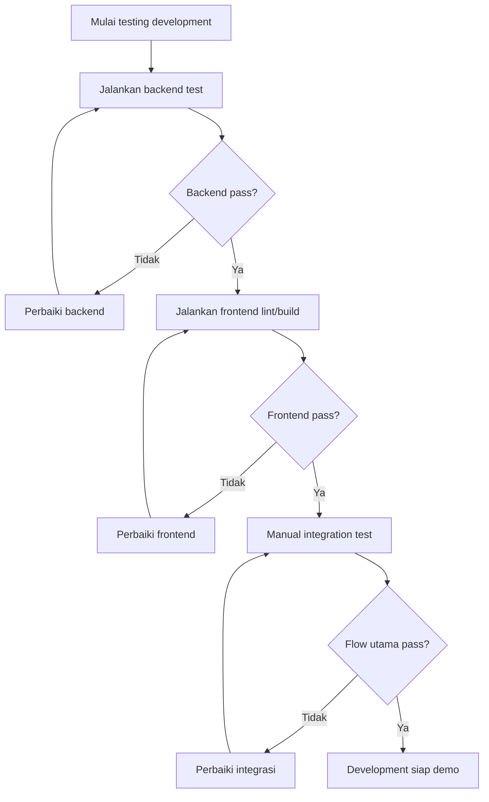

# List Pengerjaan Development TripMate AI

Dokumen ini berisi daftar pengerjaan proyek TripMate AI sampai tahap development. Fokusnya adalah mengubah kode dasar yang sudah ada menjadi aplikasi chatbot AI pemandu pariwisata Indonesia yang stabil untuk dikembangkan, diuji, dan didemokan.

## 1. Tujuan Development

Target tahap development:

1. Backend dan frontend berjalan stabil secara lokal.
2. Autentikasi, chat, session, attachment, avatar, dan preferensi user saling terhubung.
3. Integrasi Gemini API dapat digunakan dengan fallback model.
4. Avatar 3D dapat dipilih dari data backend, bukan hanya hardcoded frontend.
5. Data wisata dasar tersedia sebagai fondasi rekomendasi.
6. Dokumentasi API, database, dan flow pengerjaan tersedia.
7. Aplikasi siap masuk tahap testing lebih luas atau staging.

## 2. Ringkasan Urutan Pengerjaan

| No | Fase | Fokus | Output Utama |
| --- | --- | --- | --- |
| 1 | Persiapan environment | Menjalankan proyek lokal | Backend, frontend, database aktif |
| 2 | Audit kode dasar | Memetakan fitur dan gap | Catatan gap dan prioritas |
| 3 | Stabilitas backend | API session, avatar, preference | Endpoint backend lebih lengkap |
| 4 | Integrasi frontend-backend | Sinkronisasi data live | UI memakai data API |
| 5 | AI pariwisata | Prompt, model, fallback, logging | Chat AI lebih stabil |
| 6 | Multimodal | Upload media dan validasi | Foto/video/audio terkirim aman |
| 7 | Avatar 3D | Avatar dari backend, speaking state | Pemandu 3D sinkron dengan chat |
| 8 | Data wisata | Database destinasi awal | Rekomendasi lebih kontekstual |
| 9 | Testing development | Unit, feature, integration, UI | Bug utama terdeteksi |
| 10 | Dokumentasi dan demo | Panduan menjalankan dan demo | Development build siap presentasi |

## 3. Flowchart Besar Pengerjaan Development



## 4. Fase 1 - Persiapan Environment

### Checklist

- [ ] Pastikan PHP, Composer, Node.js, NPM, dan database tersedia.
- [ ] Salin dan konfigurasi `backend/.env` dari `.env.example`.
- [ ] Isi `APP_KEY`, database, `GEMINI_API_KEY`, dan konfigurasi storage.
- [ ] Jalankan `composer install` di folder `backend`.
- [ ] Jalankan `npm install` di folder `frontend`.
- [ ] Jalankan migration dan seeder.
- [ ] Buat symbolic link storage Laravel.
- [ ] Jalankan backend Laravel.
- [ ] Jalankan frontend Vite.
- [ ] Uji login/register dan chat sandbox/live.

### Command Development

Backend:

```bash
cd backend
composer install
php artisan key:generate
php artisan migrate --seed
php artisan storage:link
php artisan serve
```

Frontend:

```bash
cd frontend
npm install
npm run dev
```

### Output

- Backend aktif di `http://127.0.0.1:8000`.
- Frontend aktif di `http://localhost:5173`.
- Database sudah berisi user contoh dan avatar seeder.
- Aplikasi dapat masuk sandbox saat backend mati dan live saat backend aktif.

## 5. Fase 2 - Audit Kode Dasar

### Checklist

- [ ] Review `backend/routes/api.php`.
- [ ] Review `AuthController` dan `ChatController`.
- [ ] Review semua model dan migration.
- [ ] Review `frontend/src/App.jsx`.
- [ ] Review `AvatarCanvas.jsx`.
- [ ] Review `TravelWidgets.jsx`.
- [ ] Cocokkan dokumentasi API dengan route aktual.
- [ ] Catat fitur yang sudah ada.
- [ ] Catat fitur yang masih hardcoded.

### Gap yang Harus Diprioritaskan

| Gap | Dampak | Prioritas |
| --- | --- | --- |
| Belum ada `POST /api/chat/sessions` | Frontend membuat session lokal saja | Tinggi |
| Avatar masih hardcoded di frontend | Data avatar backend belum dimanfaatkan | Tinggi |
| Preferensi user belum punya endpoint | Tabel belum digunakan | Sedang |
| Label model frontend tidak sama dengan ID model backend | Model yang dipilih user tidak sepenuhnya berlaku | Tinggi |
| Widget cuaca/peta/itinerary masih mock | Pengalaman wisata belum real-time | Sedang |
| Audio belum STT server-side | Voice message belum benar-benar ditranskripsi | Sedang |
| Lip-sync masih simulasi | Avatar belum sinkron sempurna dengan suara | Rendah untuk MVP |

### Output

- Daftar prioritas development.
- Dokumentasi gap teknis.
- Keputusan urutan implementasi.

## 6. Fase 3 - Stabilitas Backend API

### 6.1 Chat Session API

Checklist:

- [ ] Tambahkan endpoint `POST /api/chat/sessions`.
- [ ] Tambahkan endpoint `PATCH /api/chat/sessions/{id}`.
- [ ] Pastikan session hanya dapat diakses pemiliknya.
- [ ] Validasi `title`, `model`, dan `avatar_id`.
- [ ] Pastikan delete session ikut menghapus messages dan attachments melalui relasi.

Endpoint target:

| Method | Endpoint | Fungsi |
| --- | --- | --- |
| `GET` | `/api/chat/sessions` | List session user |
| `POST` | `/api/chat/sessions` | Buat session baru |
| `PATCH` | `/api/chat/sessions/{id}` | Update title, model, avatar |
| `GET` | `/api/chat/sessions/{id}/messages` | Ambil pesan session |
| `POST` | `/api/chat/sessions/{id}/messages` | Kirim pesan |
| `DELETE` | `/api/chat/sessions/{id}` | Hapus session |

### 6.2 Avatar API

Checklist:

- [ ] Tambahkan `AvatarController`.
- [ ] Tambahkan `GET /api/avatars`.
- [ ] Tambahkan `GET /api/avatars/{id}`.
- [ ] Include relasi `animations`.
- [ ] Pastikan data dari `AvatarSeeder` muncul di API.

Endpoint target:

| Method | Endpoint | Fungsi |
| --- | --- | --- |
| `GET` | `/api/avatars` | List pemandu 3D |
| `GET` | `/api/avatars/{id}` | Detail avatar dan animasi |

### 6.3 User Preference API

Checklist:

- [ ] Tambahkan `UserPreferenceController`.
- [ ] Tambahkan `GET /api/preferences`.
- [ ] Tambahkan `PUT /api/preferences`.
- [ ] Buat default preference otomatis setelah register atau saat pertama diakses.
- [ ] Validasi `theme`, `enable_voice_output`, `enable_3d_avatar`, `preferred_language`, dan `preferred_voice_id`.

Endpoint target:

| Method | Endpoint | Fungsi |
| --- | --- | --- |
| `GET` | `/api/preferences` | Ambil preferensi user |
| `PUT` | `/api/preferences` | Simpan preferensi user |

### 6.4 Flowchart Backend API



### Output

- API backend lebih lengkap dan siap dipakai frontend.
- Frontend tidak perlu lagi menyimpan semua data pemandu secara hardcoded.

## 7. Fase 4 - Integrasi Frontend dan Backend

### Checklist

- [ ] Buat service/helper API agar `fetch` tidak tersebar terlalu banyak.
- [ ] Ambil daftar session dari backend setelah login.
- [ ] Buat session baru melalui `POST /api/chat/sessions`.
- [ ] Update session melalui `PATCH /api/chat/sessions/{id}` saat user mengganti avatar/model.
- [ ] Ambil daftar avatar dari `GET /api/avatars`.
- [ ] Ambil dan simpan preferensi user dari API.
- [ ] Pertahankan sandbox mode sebagai fallback.
- [ ] Tampilkan status koneksi live/sandbox dengan jelas.
- [ ] Tangani error API tanpa merusak UI.

### Flowchart Integrasi Frontend



### Output

- Data session, avatar, dan preferensi sudah berasal dari backend.
- Sandbox tetap dapat digunakan untuk demo tanpa server.

## 8. Fase 5 - AI Pariwisata dan Gemini

### Checklist

- [ ] Pindahkan daftar model AI ke konfigurasi backend.
- [ ] Buat mapping label UI ke model ID teknis.
- [ ] Validasi model yang dikirim frontend.
- [ ] Simpan model aktual yang digunakan.
- [ ] Tambahkan timeout HTTP client.
- [ ] Tambahkan logging status response Gemini.
- [ ] Rapikan error response agar tidak membocorkan detail sensitif.
- [ ] Perkuat system instruction untuk domain pariwisata Indonesia.
- [ ] Tambahkan format jawaban standar: ringkasan, rekomendasi, tips, estimasi, itinerary bila relevan.

### Flowchart Integrasi AI



### Output

- Chat AI lebih stabil.
- Fallback model terdokumentasi.
- Error lebih aman dan mudah dipahami user.

## 9. Fase 6 - Multimodal dan File Upload

### Checklist

- [ ] Validasi MIME type whitelist.
- [ ] Pisahkan batas ukuran gambar, video, dan audio.
- [ ] Simpan file di folder storage yang rapi.
- [ ] Pastikan `php artisan storage:link` terdokumentasi.
- [ ] Return attachment URL yang bisa dibuka frontend.
- [ ] Tambahkan preview attachment di frontend.
- [ ] Tambahkan delete file saat session/pesan dihapus bila diperlukan.
- [ ] Tambahkan pesan error upload yang jelas.

### MIME yang Direkomendasikan

| Jenis | MIME |
| --- | --- |
| Gambar | `image/jpeg`, `image/png`, `image/webp` |
| Video | `video/mp4`, `video/webm` |
| Audio | `audio/wav`, `audio/mpeg`, `audio/webm` |
| Dokumen opsional | `application/pdf` |

### Output

- Upload media lebih aman.
- Gemini menerima attachment yang valid.
- Frontend dapat menampilkan informasi file user.

## 10. Fase 7 - Avatar 3D dan Voice

### Checklist MVP

- [ ] Ambil daftar avatar dari backend.
- [ ] Gunakan `model_url` dari API.
- [ ] Simpan pilihan avatar ke `chat_sessions.avatar_id`.
- [ ] Gunakan `voice_id` dari avatar untuk pengembangan TTS.
- [ ] Pastikan fallback avatar muncul saat model gagal load.
- [ ] Pertahankan browser `speechSynthesis` untuk MVP.
- [ ] Sinkronkan `isSpeaking` saat audio/TTS berjalan.

### Checklist Lanjutan

- [ ] Tambah server-side TTS.
- [ ] Simpan `audio_url` pada `chat_messages`.
- [ ] Generate metadata `expression`.
- [ ] Generate metadata `visemes`.
- [ ] Mapping `expression` ke `avatar_animations`.
- [ ] Jalankan animasi sesuai metadata jawaban.

### Flowchart Avatar dan Voice



### Output

- Avatar menjadi bagian nyata dari data aplikasi.
- Voice dan animasi speaking berjalan konsisten.

## 11. Fase 8 - Fondasi Data Wisata

### Checklist

- [ ] Tambahkan migration `provinces`.
- [ ] Tambahkan migration `cities`.
- [ ] Tambahkan migration `categories`.
- [ ] Tambahkan migration `destinations`.
- [ ] Tambahkan migration `destination_media`.
- [ ] Tambahkan seeder destinasi awal.
- [ ] Buat model dan relasi.
- [ ] Tambahkan endpoint pencarian destinasi.
- [ ] Hubungkan widget peta/cuaca dengan data destinasi.

### Data Minimum Destinasi

| Field | Contoh |
| --- | --- |
| Nama | Candi Borobudur |
| Kategori | Sejarah/Budaya |
| Kota | Magelang |
| Provinsi | Jawa Tengah |
| Latitude/Longitude | `-7.6080`, `110.2040` |
| Deskripsi | Ringkasan destinasi |
| Jam buka | Sesuai data destinasi |
| Estimasi biaya | Harga tiket/perkiraan |
| Tips | Waktu terbaik, pakaian, etika |

### Flowchart Data Wisata



### Output

- Sistem punya basis data wisata awal.
- Rekomendasi tidak hanya bergantung pada prompt AI.

## 12. Fase 9 - Testing Development

### Backend Test

- [ ] Register sukses.
- [ ] Register gagal karena email duplikat.
- [ ] Login sukses.
- [ ] Login gagal karena password salah.
- [ ] Logout mencabut token.
- [ ] User hanya melihat session miliknya.
- [ ] Create session sukses.
- [ ] Update session sukses.
- [ ] Send message teks sukses.
- [ ] Send message dengan attachment sukses.
- [ ] Gemini error ditangani dengan response aman.
- [ ] Avatar list endpoint sukses.
- [ ] Preference get/update sukses.

### Frontend Test

- [ ] Sandbox mode berjalan tanpa backend.
- [ ] Live mode aktif setelah login.
- [ ] Session dari backend tampil.
- [ ] Buat session baru dari UI.
- [ ] Pilih avatar dari data backend.
- [ ] Kirim pesan teks.
- [ ] Upload file.
- [ ] Rekam suara.
- [ ] Speech output berjalan.
- [ ] Avatar fallback bekerja.
- [ ] Widget peta/cuaca/itinerary muncul sesuai konteks.

### Flowchart Testing



### Output

- Bug utama development ditemukan dan diperbaiki.
- Flow login, chat, media, avatar, dan session siap demo.

## 13. Fase 10 - Dokumentasi dan Demo Development

### Checklist Dokumentasi

- [ ] Update `docs/api-endpoints.md` sesuai endpoint aktual.
- [ ] Update `docs/database-design.md` bila ada migration baru.
- [ ] Update `docs/changelog.md`.
- [ ] Tambahkan panduan menjalankan backend.
- [ ] Tambahkan panduan menjalankan frontend.
- [ ] Tambahkan panduan isi `.env` tanpa membocorkan secret.
- [ ] Tambahkan skenario demo.

### Skenario Demo

1. Buka frontend.
2. Tunjukkan sandbox mode.
3. Login atau register.
4. Tunjukkan live mode.
5. Pilih pemandu Budi untuk sejarah/budaya.
6. Tanya tentang Candi Borobudur.
7. Tampilkan jawaban AI, peta, dan cuaca.
8. Upload gambar destinasi.
9. Tunjukkan respons multimodal.
10. Ganti pemandu Siti atau Aditya.
11. Buat session baru.
12. Tunjukkan riwayat session tersimpan.

### Output

- Development build siap dipresentasikan.
- Dokumentasi cukup untuk developer lain menjalankan proyek.

## 14. Prioritas Implementasi Mingguan

### Minggu 1 - Stabilitas Dasar

- [ ] Setup environment.
- [ ] Rapikan `.env.example`.
- [ ] Jalankan migration dan seeder.
- [ ] Audit route, controller, model, dan frontend.
- [ ] Update dokumentasi API awal.

### Minggu 2 - Backend Core API

- [ ] Implement create/update session.
- [ ] Implement avatar API.
- [ ] Implement preference API.
- [ ] Tambahkan validasi request.
- [ ] Tambahkan feature test backend.

### Minggu 3 - Frontend Live Integration

- [ ] Ambil session dari backend.
- [ ] Ambil avatar dari backend.
- [ ] Integrasikan preference.
- [ ] Sinkronkan model AI.
- [ ] Rapikan error handling live/sandbox.

### Minggu 4 - AI dan Multimodal

- [ ] Rapikan konfigurasi model Gemini.
- [ ] Tambahkan timeout/retry/logging.
- [ ] Perketat validasi upload.
- [ ] Tambahkan preview attachment.
- [ ] Uji chat teks, gambar, video, dan audio.

### Minggu 5 - Data Wisata dan Widget

- [ ] Tambah tabel destinasi dasar.
- [ ] Tambah seeder destinasi awal.
- [ ] Tambah endpoint destinasi.
- [ ] Hubungkan widget peta/cuaca ke data destinasi.
- [ ] Siapkan fondasi RAG sederhana.

### Minggu 6 - Testing dan Demo

- [ ] Jalankan backend test.
- [ ] Jalankan frontend build/lint.
- [ ] Uji manual flow utama.
- [ ] Update seluruh dokumentasi.
- [ ] Siapkan skenario demo development.

## 15. Definition of Done Tahap Development

Tahap development dianggap selesai jika:

- [ ] Backend dapat dijalankan tanpa error.
- [ ] Frontend dapat dijalankan tanpa error.
- [ ] User dapat register, login, logout.
- [ ] User dapat membuat, melihat, dan menghapus session.
- [ ] User dapat mengirim pesan teks ke AI.
- [ ] User dapat mengunggah attachment valid.
- [ ] AI menjawab dengan konteks pariwisata Indonesia.
- [ ] Avatar dapat dipilih dan ditampilkan.
- [ ] Preferensi user dapat disimpan.
- [ ] Minimal data destinasi wisata tersedia.
- [ ] Test utama berjalan.
- [ ] Dokumentasi API dan development diperbarui.

## 16. Catatan Implementasi

Urutan paling aman untuk dikerjakan adalah backend API terlebih dahulu, lalu frontend integration, kemudian AI/multimodal/avatar lanjutan. Dengan begitu, UI tidak terus bergantung pada data hardcoded dan setiap fitur punya kontrak API yang jelas.

Untuk MVP development, browser `speechSynthesis` dan simulasi mouth movement sudah cukup. Server-side TTS, viseme, dan RAG dapat masuk setelah flow utama chat, session, avatar, dan upload stabil.

