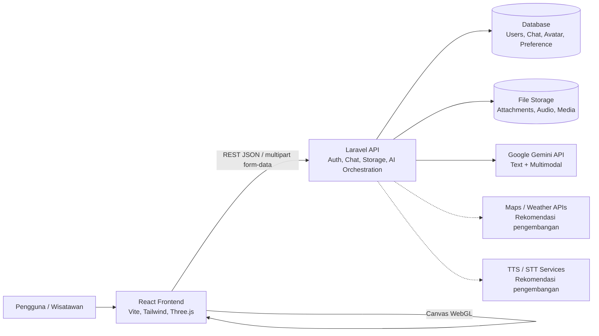
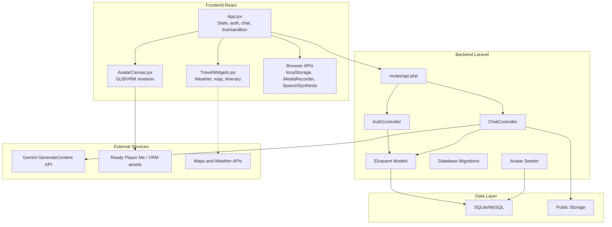
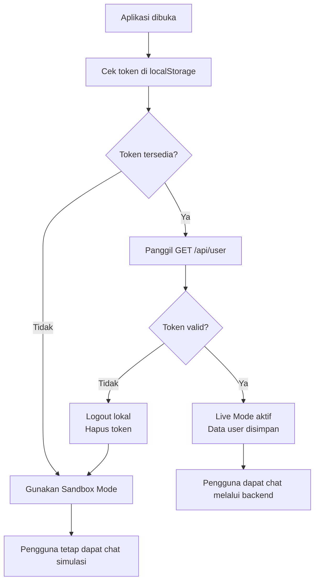
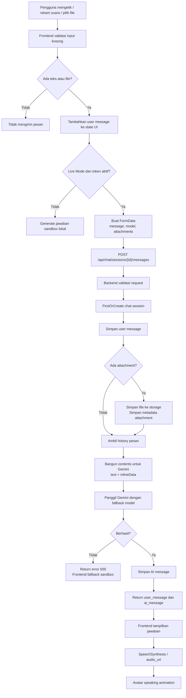
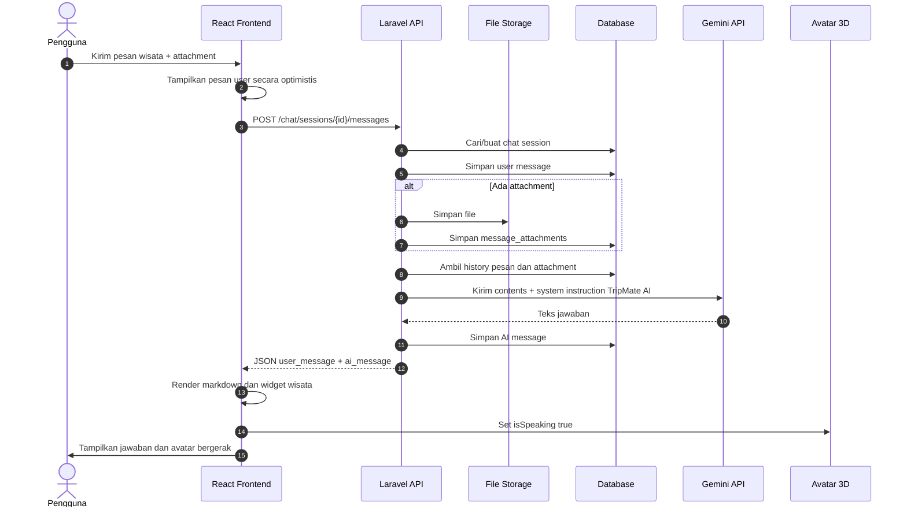
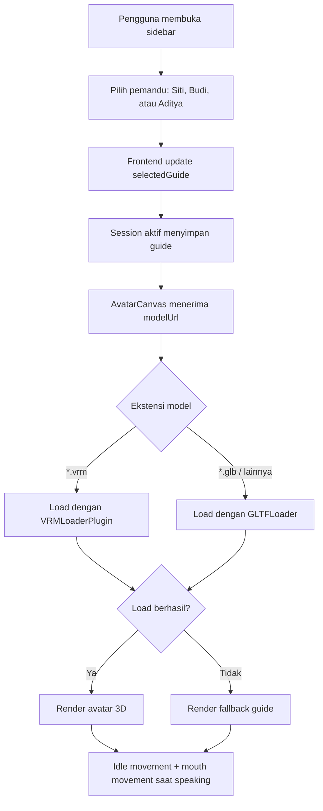
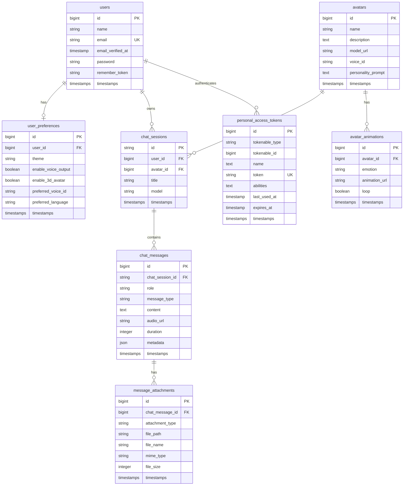
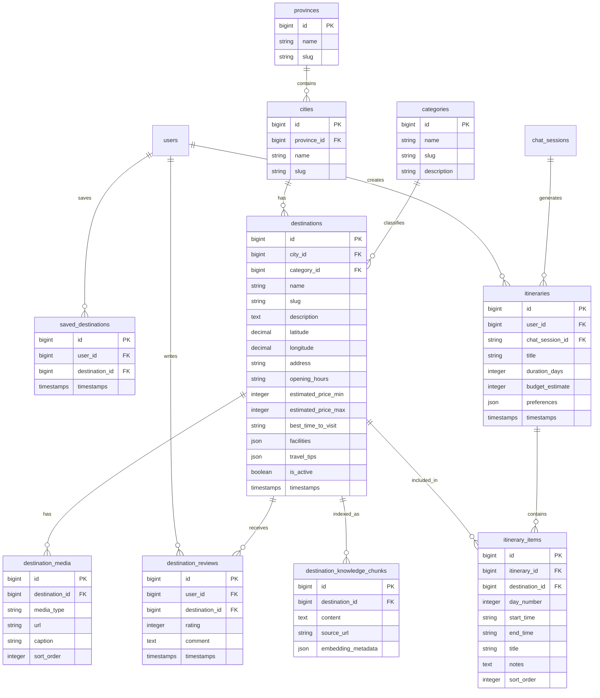
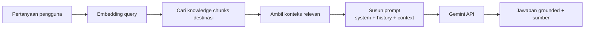

# Proposal Perancangan Sistem TripMate AI

## 1. Identitas Dokumen

| Item | Keterangan |
| --- | --- |
| Nama sistem | TripMate AI |
| Jenis sistem | Aplikasi chatbot AI pemandu pariwisata Indonesia dengan avatar 3D interaktif |
| Basis kode | Laravel 13 backend, React/Vite frontend, Three.js avatar 3D |
| Tanggal penyusunan | 2026-07-02 |
| Lokasi dokumen | `docs/proposal-perancangan-sistem.md` |

## 2. Ringkasan Eksekutif

TripMate AI dirancang sebagai asisten pariwisata digital yang membantu pengguna menjelajahi destinasi wisata Indonesia melalui percakapan AI, analisis media multimodal, pemandu 3D interaktif, rekomendasi itinerary, peta, cuaca, dan informasi budaya/kuliner. Sistem sudah memiliki fondasi yang kuat:

- Backend Laravel 13 dengan autentikasi Sanctum.
- Frontend React + Vite dengan mode sandbox dan live API.
- Integrasi Gemini API untuk respons AI multimodal.
- Penyimpanan sesi chat, pesan, attachment, avatar, animasi avatar, dan preferensi pengguna.
- Avatar 3D berbasis Three.js, React Three Fiber, GLB Ready Player Me, dan dukungan VRM.
- Widget wisata berupa cuaca, peta, dan itinerary.

Proposal ini menyusun rancangan sistem lengkap berdasarkan kode dasar yang tersedia, sekaligus memberi arah pengembangan agar sistem menjadi aplikasi pemandu wisata Indonesia yang siap digunakan secara nyata.

## 3. Latar Belakang

Indonesia memiliki destinasi wisata yang sangat luas: wisata alam, budaya, sejarah, religi, kuliner, desa adat, museum, taman nasional, festival, sampai rekreasi keluarga. Wisatawan sering membutuhkan panduan yang personal, cepat, interaktif, dan mudah dipahami.

TripMate AI menjawab kebutuhan tersebut dengan menggabungkan:

- Percakapan natural dalam bahasa Indonesia.
- Pemahaman konteks wisata berbasis teks, foto, video, dan suara.
- Avatar 3D yang memberi pengalaman pemandu lebih hidup.
- Rekomendasi perjalanan yang dapat dipersonalisasi.
- Integrasi peta, cuaca, itinerary, dan referensi destinasi.

## 4. Tujuan Sistem

Tujuan utama sistem adalah menjadi pemandu pariwisata AI untuk Indonesia yang dapat:

1. Menjawab pertanyaan wisata secara ramah, informatif, dan terstruktur.
2. Memberikan rekomendasi destinasi, kuliner, budaya, sejarah, dan aktivitas.
3. Membantu pengguna menyusun itinerary berdasarkan durasi, budget, lokasi, minat, dan gaya perjalanan.
4. Menganalisis media seperti foto/video destinasi, makanan khas, atau peta.
5. Memberikan pengalaman interaktif melalui avatar 3D, suara, animasi, dan ekspresi.
6. Menyimpan riwayat percakapan pengguna secara aman.
7. Menjadi fondasi untuk fitur lanjutan seperti RAG wisata, reservasi, admin destinasi, dan analitik.

## 5. Ruang Lingkup

### 5.1 Ruang Lingkup MVP Saat Ini

Berdasarkan kode dasar, cakupan yang sudah tersedia atau sudah disiapkan adalah:

- Registrasi, login, logout menggunakan Laravel Sanctum.
- Mode live API dan sandbox lokal pada frontend.
- Sesi percakapan wisata.
- Pengiriman pesan teks.
- Upload attachment gambar, video, dan audio.
- Penyimpanan pesan dan attachment di database/storage.
- Pengiriman conversation history dan inline media ke Gemini API.
- Fallback model Gemini: `gemini-2.5-flash`, `gemini-2.0-flash`, `gemini-1.5-flash`.
- Avatar pemandu 3D dengan pilihan Siti, Budi, dan Aditya.
- Animasi idle sederhana, auto rotate, orbit control, dan mouth movement saat berbicara.
- Text-to-speech browser melalui `speechSynthesis`.
- Recording suara browser melalui `MediaRecorder`.
- Widget wisata berbasis konten: cuaca, peta, dan itinerary.

### 5.2 Ruang Lingkup Pengembangan

Fitur yang direkomendasikan sebagai pengembangan berikutnya:

- Endpoint eksplisit untuk membuat sesi chat.
- API avatar agar frontend tidak lagi hardcoded.
- API preferensi pengguna.
- Normalisasi pilihan model AI antara frontend dan backend.
- Server-side STT untuk transkripsi audio.
- Server-side TTS dan lip-sync metadata untuk avatar.
- RAG destinasi wisata Indonesia dengan database destinasi.
- Admin panel untuk mengelola destinasi, artikel, media, dan pemandu.
- Integrasi cuaca/peta nyata.
- Sistem favorite, review, itinerary tersimpan, dan rekomendasi personal.
- Observability, rate limit, audit log, dan moderasi konten.

## 6. Pemangku Kepentingan

| Aktor | Peran |
| --- | --- |
| Wisatawan/pengguna | Bertanya, mengunggah media, menyimpan sesi, meminta itinerary |
| Admin konten | Mengelola data destinasi, kuliner, budaya, event, dan media |
| Sistem AI | Memahami input, membuat jawaban, memberi rekomendasi |
| Avatar 3D | Menampilkan pemandu virtual, animasi, ekspresi, dan lip-sync |
| Backend API | Menjaga autentikasi, data, file, history, dan integrasi AI |
| Layanan eksternal | Gemini API, maps, weather, TTS/STT, object storage |

## 7. Kondisi Kode Saat Ini

### 7.1 Struktur Proyek

```text
AI-Chatbot3D/
|-- backend/      Laravel 13 API backend
|-- frontend/     React + Vite frontend
|-- docs/         Dokumentasi proyek
|-- README.md     Panduan umum proyek
```

### 7.2 Backend

Backend menggunakan Laravel 13 dengan komponen utama:

- `routes/api.php`: route autentikasi dan chat.
- `AuthController`: register, login, logout.
- `ChatController`: pesan multimodal, penyimpanan chat, integrasi Gemini.
- Model: `User`, `ChatSession`, `ChatMessage`, `MessageAttachment`, `Avatar`, `AvatarAnimation`, `UserPreference`.
- Migration: tabel user, token Sanctum, sesi chat, pesan, attachment, avatar, animasi, preferensi.
- Seeder: `AvatarSeeder` untuk pemandu Siti, Budi, dan Aditya.

### 7.3 Frontend

Frontend menggunakan React/Vite dengan komponen utama:

- `App.jsx`: shell utama aplikasi, state chat, auth, live/sandbox, upload, voice, widget, dan UI.
- `AvatarCanvas.jsx`: rendering avatar GLB/VRM dengan React Three Fiber.
- `TravelWidgets.jsx`: widget cuaca, peta, dan itinerary.
- `ErrorBoundary.jsx`: fallback error komponen React.
- `index.css`: styling global berbasis Tailwind CSS.

### 7.4 Catatan Kesenjangan Saat Ini

| Area | Kondisi saat ini | Rekomendasi |
| --- | --- | --- |
| Sesi chat | Backend membuat sesi lewat `firstOrCreate` saat pesan pertama dikirim | Tambahkan `POST /chat/sessions` eksplisit |
| Model AI | Frontend memakai label seperti `Gemini 2.5 Pro`, backend memakai fallback model Gemini fixed | Buat mapping model resmi dan validasi input |
| Avatar | Frontend hardcoded daftar pemandu, backend sudah punya tabel dan seeder avatar | Tambahkan endpoint `GET /avatars` |
| Preferensi | Tabel `user_preferences` sudah ada | Tambahkan endpoint baca/simpan preferensi |
| Voice | Frontend merekam audio dan TTS browser | Tambahkan STT/TTS server-side |
| Lip-sync | Avatar memakai simulasi mouth movement saat speaking | Simpan viseme di `chat_messages.metadata` |
| Widget wisata | Widget masih mock berbasis keyword | Integrasikan API cuaca, peta, destinasi, dan itinerary nyata |
| Knowledge wisata | Prompt sistem sudah wisata Indonesia | Tambahkan database/RAG destinasi agar jawaban lebih grounded |

## 8. Kebutuhan Fungsional

### 8.1 Autentikasi

1. Pengguna dapat membuat akun.
2. Pengguna dapat login dan menerima token Sanctum.
3. Pengguna dapat logout dan token aktif dicabut.
4. Pengguna yang sudah login dapat mengakses riwayat sesi.

### 8.2 Percakapan AI

1. Pengguna dapat membuat sesi percakapan wisata.
2. Pengguna dapat mengirim pesan teks.
3. Pengguna dapat mengunggah gambar, video, atau audio.
4. Sistem menyimpan pesan pengguna, attachment, dan jawaban AI.
5. Sistem mengirim riwayat percakapan ke model AI untuk konteks.
6. Sistem mengembalikan jawaban AI dalam format markdown.
7. Sistem dapat fallback ke mode sandbox bila backend tidak aktif.

### 8.3 Multimodal

1. Pengguna dapat mengunggah foto destinasi, makanan, peta, atau objek wisata.
2. Backend menyimpan file ke storage publik.
3. Backend mengirim file sebagai `inlineData` base64 ke Gemini API.
4. AI menjawab berdasarkan teks dan media yang dikirim.
5. Sistem membatasi ukuran file untuk mencegah penyalahgunaan.

### 8.4 Avatar 3D

1. Pengguna dapat memilih pemandu virtual.
2. Avatar memuat model GLB atau VRM.
3. Avatar bergerak idle dan dapat dirotasi.
4. Avatar merespons kondisi speaking dengan mouth movement.
5. Ke depan, avatar memakai ekspresi dan viseme dari metadata AI.

### 8.5 Pemandu Wisata

1. Sistem menyediakan persona pemandu:
   - Siti: alam dan petualangan.
   - Budi: sejarah dan budaya.
   - Aditya: kuliner dan rekreasi keluarga.
2. Sistem memberi rekomendasi destinasi Indonesia.
3. Sistem memberi tips budaya, transportasi, biaya, keamanan, dan etika lokal.
4. Sistem membuat itinerary harian.
5. Sistem menampilkan widget peta, cuaca, dan rencana perjalanan saat relevan.

### 8.6 Preferensi Pengguna

1. Pengguna dapat menyimpan tema.
2. Pengguna dapat mengaktifkan/menonaktifkan suara.
3. Pengguna dapat mengaktifkan/menonaktifkan avatar 3D.
4. Pengguna dapat memilih bahasa utama.
5. Pengguna dapat memilih voice ID favorit.

## 9. Kebutuhan Non-Fungsional

| Kategori | Kebutuhan |
| --- | --- |
| Performa | Respons UI tetap cepat, upload file dibatasi, model 3D dioptimasi |
| Skalabilitas | API stateless, storage dapat dipindah ke S3-compatible object storage |
| Keamanan | Token Sanctum, validasi input, pembatasan file, rate limit, secret di `.env` |
| Reliabilitas | Fallback model AI, logging error, fallback sandbox frontend |
| Maintainability | Dokumentasi API, migration rapi, pemisahan frontend/backend jelas |
| Aksesibilitas | Kontrol keyboard, label tombol, teks dapat dibaca |
| Privasi | Riwayat chat hanya dapat diakses pemilik sesi |
| Observability | Logging integrasi AI, audit request, metrik error dan latency |

## 10. Arsitektur Sistem

### 10.1 Diagram Konteks



### 10.2 Arsitektur Komponen



### 10.3 Pola Arsitektur

Sistem memakai pola decoupled client-server:

- Frontend bertanggung jawab pada pengalaman pengguna, 3D, state sementara, dan rendering.
- Backend bertanggung jawab pada autentikasi, validasi, database, storage, dan integrasi model AI.
- Layanan AI eksternal dipanggil dari backend, bukan dari frontend, agar API key aman.
- Database menyimpan data utama yang perlu persisten.
- Storage menyimpan file media yang diunggah pengguna.

## 11. Alur Sistem

### 11.1 Flowchart Autentikasi dan Mode Koneksi



### 11.2 Flowchart Kirim Pesan



### 11.3 Sequence Diagram Percakapan Multimodal



### 11.4 Flowchart Pemilihan Avatar



## 12. Desain Database

### 12.1 ERD Sesuai Kode Saat Ini



### 12.2 Kamus Data Inti

#### `users`

| Kolom | Tipe | Fungsi |
| --- | --- | --- |
| `id` | bigint | Primary key pengguna |
| `name` | string | Nama pengguna |
| `email` | string unique | Identitas login |
| `password` | string | Password ter-hash |
| `email_verified_at` | timestamp nullable | Status verifikasi email |

#### `chat_sessions`

| Kolom | Tipe | Fungsi |
| --- | --- | --- |
| `id` | string PK | ID sesi dari frontend, misalnya `session-...` |
| `user_id` | FK | Pemilik sesi |
| `avatar_id` | FK nullable | Avatar yang digunakan dalam sesi |
| `title` | string | Judul sesi |
| `model` | string | Model AI yang dipilih/terpakai |

#### `chat_messages`

| Kolom | Tipe | Fungsi |
| --- | --- | --- |
| `chat_session_id` | FK | Relasi ke sesi |
| `role` | string | `user`, `model`, atau `system` |
| `message_type` | string | `text`, `audio`, `image`, `video`, `multimodal` |
| `content` | text nullable | Isi pesan atau transkrip |
| `audio_url` | string nullable | URL hasil TTS atau rekaman |
| `duration` | integer nullable | Durasi audio |
| `metadata` | json nullable | Ekspresi, viseme, blendshape, info widget |

#### `message_attachments`

| Kolom | Tipe | Fungsi |
| --- | --- | --- |
| `chat_message_id` | FK | Pesan pemilik attachment |
| `attachment_type` | string | `image`, `video`, `audio`, atau `document` |
| `file_path` | string | Lokasi file pada storage |
| `file_name` | string | Nama asli file |
| `mime_type` | string | MIME type file |
| `file_size` | integer | Ukuran file dalam bytes |

#### `avatars`

| Kolom | Tipe | Fungsi |
| --- | --- | --- |
| `name` | string | Nama pemandu, contoh Siti |
| `description` | text nullable | Deskripsi spesialisasi pemandu |
| `model_url` | string | URL GLB atau VRM |
| `voice_id` | string nullable | ID suara TTS |
| `personality_prompt` | text nullable | Prompt khusus persona avatar |

#### `avatar_animations`

| Kolom | Tipe | Fungsi |
| --- | --- | --- |
| `avatar_id` | FK | Avatar pemilik animasi |
| `emotion` | string | `neutral`, `greeting`, `happy`, `thinking`, dll |
| `animation_url` | string | URL file animasi |
| `loop` | boolean | Apakah animasi diulang |

#### `user_preferences`

| Kolom | Tipe | Fungsi |
| --- | --- | --- |
| `user_id` | FK | Pemilik preferensi |
| `theme` | string | Tema UI |
| `enable_voice_output` | boolean | Status output suara |
| `enable_3d_avatar` | boolean | Status avatar 3D |
| `preferred_voice_id` | string nullable | Voice ID favorit |
| `preferred_language` | string | Bahasa utama, contoh `id` |

### 12.3 ERD Rekomendasi Pengembangan Domain Pariwisata

Database saat ini sudah cukup untuk chat dan avatar. Agar sistem menjadi pemandu wisata yang lebih akurat, disarankan menambahkan domain data pariwisata berikut.



### 12.4 Rekomendasi Normalisasi Data

1. `chat_sessions.avatar_id` sebaiknya benar-benar digunakan dari pilihan pemandu frontend.
2. `chat_sessions.model` sebaiknya menyimpan ID model teknis, bukan hanya label UI.
3. `chat_messages.metadata` dapat menyimpan:

```json
{
  "expression": "happy",
  "animation": "greeting",
  "visemes": [
    { "time_ms": 0, "value": "sil" },
    { "time_ms": 120, "value": "aa" }
  ],
  "widgets": [
    { "type": "map", "destination": "Candi Borobudur" },
    { "type": "weather", "destination": "Magelang" }
  ],
  "grounding": {
    "destination_ids": [1, 2],
    "sources": ["internal_destination_database"]
  }
}
```

## 13. Desain API

### 13.1 API Saat Ini Berdasarkan Route

| Method | Endpoint | Auth | Fungsi |
| --- | --- | --- | --- |
| `POST` | `/api/register` | Tidak | Membuat user dan token |
| `POST` | `/api/login` | Tidak | Login dan token |
| `GET` | `/api/user` | Sanctum | Mengambil user aktif |
| `POST` | `/api/logout` | Sanctum | Mencabut token aktif |
| `GET` | `/api/chat/sessions` | Sanctum | List sesi user |
| `GET` | `/api/chat/sessions/{id}/messages` | Sanctum | List pesan dalam sesi |
| `POST` | `/api/chat/sessions/{id}/messages` | Sanctum | Kirim pesan dan attachment |
| `DELETE` | `/api/chat/sessions/{id}` | Sanctum | Hapus sesi |

### 13.2 Request Kirim Pesan

Endpoint:

```http
POST /api/chat/sessions/{id}/messages
Authorization: Bearer {token}
Accept: application/json
Content-Type: multipart/form-data
```

Field:

| Field | Tipe | Wajib | Keterangan |
| --- | --- | --- | --- |
| `message` | string | Tidak | Teks pertanyaan |
| `model` | string | Tidak | Model yang dipilih frontend |
| `attachments[]` | file[] | Tidak | Gambar, video, atau audio, maksimum 20 MB per file |

Respons sukses:

```json
{
  "user_message": {
    "id": 1,
    "role": "user",
    "content": "Buat itinerary 3 hari di Bali",
    "created_at": "2026-07-02T00:00:00.000000Z",
    "attachments": []
  },
  "ai_message": {
    "id": 2,
    "role": "assistant",
    "content": "Berikut itinerary 3 hari di Bali...",
    "created_at": "2026-07-02T00:00:03.000000Z"
  }
}
```

### 13.3 API Rekomendasi

| Method | Endpoint | Fungsi |
| --- | --- | --- |
| `POST` | `/api/chat/sessions` | Membuat sesi baru secara eksplisit |
| `PATCH` | `/api/chat/sessions/{id}` | Mengubah judul, avatar, atau model |
| `GET` | `/api/avatars` | Mengambil daftar pemandu 3D |
| `GET` | `/api/avatars/{id}` | Detail avatar dan animasinya |
| `GET` | `/api/preferences` | Mengambil preferensi pengguna |
| `PUT` | `/api/preferences` | Menyimpan preferensi pengguna |
| `GET` | `/api/destinations` | Mencari destinasi wisata |
| `GET` | `/api/destinations/{slug}` | Detail destinasi |
| `POST` | `/api/itineraries` | Menyimpan itinerary hasil chat |
| `GET` | `/api/itineraries` | List itinerary user |
| `POST` | `/api/media/transcribe` | Transkripsi audio menjadi teks |
| `POST` | `/api/speech/synthesize` | Membuat audio TTS dan metadata lip-sync |

## 14. Teknologi yang Digunakan

### 14.1 Frontend

| Teknologi | Fungsi |
| --- | --- |
| React 19 | Membangun UI interaktif |
| Vite 8 | Development server dan bundler |
| Tailwind CSS 4 | Styling utility-first |
| Three.js | Rendering 3D WebGL |
| `@react-three/fiber` | Integrasi React dengan Three.js |
| `@react-three/drei` | Helper Three.js, termasuk `OrbitControls` |
| `@pixiv/three-vrm` | Loader avatar VRM |
| `lucide-react` | Ikon UI |
| Browser `MediaRecorder` | Rekam suara pengguna |
| Browser `speechSynthesis` | TTS lokal browser |
| `localStorage` | Menyimpan token, user, sesi sandbox, dan chat lokal |
| Fetch API + FormData | Komunikasi REST dan upload file |

### 14.2 Backend

| Teknologi | Fungsi |
| --- | --- |
| PHP 8.3+ | Runtime backend |
| Laravel 13 | Framework API |
| Laravel Sanctum | Token authentication |
| Eloquent ORM | Model dan relasi database |
| Laravel Migration | Versioning skema database |
| Laravel Storage | Penyimpanan attachment |
| Laravel HTTP Client | Integrasi Gemini API |
| Laravel Logging | Logging error integrasi AI |
| PHPUnit | Testing backend |

### 14.3 Database dan Storage

| Teknologi | Fungsi |
| --- | --- |
| SQLite | Development lokal cepat |
| MySQL/MariaDB | Alternatif production atau XAMPP |
| Public disk Laravel | Storage attachment lokal |
| S3-compatible storage | Rekomendasi production untuk file media |

### 14.4 AI dan Layanan Eksternal

| Layanan | Status | Fungsi |
| --- | --- | --- |
| Google Gemini API | Sudah dipakai backend | Chat multimodal |
| Ready Player Me | Sudah dipakai frontend/seeder | Avatar GLB |
| VRM assets | Didukung frontend | Avatar VRM |
| Google Maps Embed | Sudah dipakai widget | Peta destinasi |
| Weather API | Rekomendasi | Cuaca real-time |
| STT service | Rekomendasi | Transkripsi voice message |
| TTS service | Rekomendasi | Suara natural + viseme |
| Vector database | Rekomendasi | RAG data wisata |

## 15. Desain AI

### 15.1 Persona Sistem

Backend sudah memiliki instruksi sistem yang mendefinisikan TripMate AI sebagai pemandu wisata Indonesia yang:

- Hangat dan ramah.
- Ahli destinasi wisata, sejarah, budaya, kuliner, dan itinerary.
- Dapat menganalisis gambar/video destinasi, makanan, atau peta.
- Dapat menanggapi pesan suara.
- Memberikan rekomendasi personal.

### 15.2 Strategi Model

Saat ini backend memakai fallback:

1. `gemini-2.5-flash`
2. `gemini-2.0-flash`
3. `gemini-1.5-flash`

Rekomendasi:

- Simpan konfigurasi model dalam satu file config, misalnya `config/ai.php`.
- Bedakan label UI dan model ID teknis.
- Validasi model dari frontend.
- Simpan `used_model` aktual pada `chat_sessions` atau `chat_messages.metadata`.
- Tambahkan timeout, retry policy, dan rate limit.

### 15.3 RAG Pariwisata

Untuk jawaban wisata yang lebih akurat, sistem disarankan memakai Retrieval-Augmented Generation:



Sumber data internal yang dapat dimasukkan:

- Profil destinasi.
- Deskripsi sejarah.
- Jam buka dan harga tiket.
- Akses transportasi.
- Tips budaya dan keselamatan.
- Kuliner sekitar.
- Event/festival.
- Foto dan caption media.

## 16. Desain Avatar 3D

### 16.1 Avatar Saat Ini

Sistem frontend mendukung:

- GLB dengan `GLTFLoader`.
- VRM dengan `VRMLoaderPlugin`.
- Fallback guide bila model gagal dimuat.
- Idle body motion.
- Mouth movement saat `isSpeaking` aktif.
- Orbit controls, auto rotate, zoom, dan lighting.

### 16.2 Persona Pemandu

| Pemandu | Spesialisasi | Karakter |
| --- | --- | --- |
| Siti | Alam dan petualangan | Energik, ramah, outdoor |
| Budi | Sejarah dan budaya | Santun, bijaksana, detail |
| Aditya | Kuliner dan rekreasi | Ceria, santai, family-friendly |

### 16.3 Rekomendasi Metadata Avatar

Jawaban AI sebaiknya menghasilkan metadata terpisah untuk frontend:

```json
{
  "text": "Candi Borobudur paling indah dikunjungi saat pagi hari...",
  "avatar": {
    "expression": "happy",
    "animation": "explaining",
    "voice_id": "AZnzlk1XvdvUeBnXmlld",
    "visemes": [
      { "time_ms": 0, "mouth": "sil" },
      { "time_ms": 80, "mouth": "aa" }
    ]
  }
}
```

Manfaat:

- Frontend tidak perlu menebak ekspresi dari teks.
- Lip-sync menjadi sinkron dengan audio.
- Animasi pemandu dapat dipilih sesuai konteks jawaban.

## 17. Desain UI/UX

### 17.1 Layar Utama

Komponen utama layar:

- Area avatar 3D sebagai pemandu utama.
- Panel chat yang bisa disembunyikan.
- Input teks.
- Tombol kirim.
- Tombol rekam suara.
- Tombol upload foto/video.
- Quick actions: jelajahi, peta, jadwal, suara, foto, bagikan.
- Sidebar sesi dan pilihan pemandu.
- Modal pengaturan untuk API URL dan autentikasi.

### 17.2 Prinsip UX

1. Pengguna harus bisa langsung bertanya tanpa memahami konfigurasi teknis.
2. Mode sandbox menjaga aplikasi tetap dapat dicoba walaupun backend mati.
3. Live mode memberi pengalaman penuh dengan history dan AI nyata.
4. Avatar harus membantu rasa "dipandu", bukan mengganggu percakapan.
5. Widget wisata muncul kontekstual, bukan selalu memenuhi layar.
6. Informasi wisata harus mudah dipindai: daftar, jadwal, peta, cuaca, biaya.

## 18. Keamanan

### 18.1 Keamanan Saat Ini

- Password di-hash oleh Laravel.
- Endpoint chat dilindungi `auth:sanctum`.
- User hanya dapat mengakses sesi miliknya.
- API key Gemini berada di backend `.env`, bukan frontend.
- Attachment divalidasi sebagai file dengan batas 20 MB.

### 18.2 Rekomendasi Keamanan

| Risiko | Rekomendasi |
| --- | --- |
| Token disimpan di localStorage | Pertimbangkan cookie httpOnly bila frontend/backend satu domain |
| Upload file berbahaya | Validasi MIME whitelist, scan file, batasi ekstensi |
| Abuse AI API | Tambahkan rate limit per user/IP |
| Biaya API membengkak | Tambahkan quota harian dan logging token/usage |
| Prompt injection | Pisahkan system prompt, sanitasi input, gunakan guardrail |
| Kebocoran data user | Pastikan semua query memakai scope user |
| File publik sensitif | Pisahkan media privat dan signed URL |
| CORS terlalu longgar | Batasi origin production |

## 19. Deployment

### 19.1 Development Lokal

Backend:

```bash
cd backend
composer install
php artisan migrate --seed
php artisan storage:link
php artisan serve
```

Frontend:

```bash
cd frontend
npm install
npm run dev
```

URL default:

- Backend: `http://127.0.0.1:8000`
- Frontend: `http://localhost:5173`
- API: `http://localhost:8000/api`

### 19.2 Production

Rekomendasi production:

- Frontend build statis via Vite.
- Backend Laravel di PHP-FPM/Nginx atau platform managed.
- Database MySQL/PostgreSQL.
- Object storage untuk media.
- Queue worker untuk STT/TTS, embedding, dan proses berat.
- HTTPS wajib.
- Environment variable dikelola oleh secret manager.
- Monitoring error dan latency.

## 20. Testing

### 20.1 Backend Testing

Prioritas test:

- Register sukses dan validasi gagal.
- Login sukses dan kredensial salah.
- Logout mencabut token.
- User tidak dapat membaca sesi milik user lain.
- Kirim pesan teks menyimpan user message dan AI message.
- Upload attachment menyimpan metadata file.
- Gemini error menghasilkan respons error yang aman.
- Delete session menghapus messages dan attachments secara relasional.

### 20.2 Frontend Testing

Prioritas test:

- Aplikasi masuk sandbox saat backend tidak tersedia.
- Login/register menyimpan token dan user.
- Pengiriman pesan live membuat FormData benar.
- Upload file tampil sebagai selected files.
- Voice recording membuat file audio.
- Avatar fallback muncul saat model gagal dimuat.
- Widget muncul saat konten menyebut Borobudur, Kelingking, atau Yogyakarta.
- Layout tetap rapi di desktop dan mobile.

### 20.3 Integration Testing

Skenario penting:

1. User register -> login -> kirim pesan -> mendapat jawaban AI -> sesi tersimpan.
2. User upload gambar destinasi -> backend kirim inlineData -> jawaban muncul.
3. Backend gagal Gemini -> frontend fallback sandbox.
4. User memilih pemandu -> session menyimpan avatar -> avatar sesuai muncul.

## 21. Roadmap Pengembangan

### Fase 1: Stabilkan MVP

- Tambah endpoint create/update session.
- Tambah endpoint avatar.
- Tambah endpoint user preferences.
- Sinkronkan model label frontend dengan model backend.
- Tambah validasi MIME attachment.
- Update dokumentasi API sesuai route aktual.

### Fase 2: Wisata Indonesia Grounded

- Tambah tabel destinasi, kategori, kota, provinsi, media, dan knowledge chunks.
- Buat admin CRUD destinasi.
- Bangun RAG untuk jawaban wisata.
- Tambah sumber data internal dan citation ringan pada jawaban.

### Fase 3: Voice dan Avatar Lanjutan

- Tambah STT server-side.
- Tambah TTS server-side.
- Generate `audio_url`, `duration`, `visemes`, dan `expression`.
- Mapping emotion ke `avatar_animations`.
- Sinkronkan audio dengan lip-sync.

### Fase 4: Itinerary dan Personalisasi

- Simpan itinerary hasil chat.
- Tambah favorite destinasi.
- Tambah preferensi budget, durasi, gaya wisata, dan bahasa.
- Rekomendasi destinasi berdasarkan history.

### Fase 5: Production Hardening

- Queue worker untuk proses berat.
- Rate limiting dan quota.
- Monitoring, analytics, dan logging penggunaan AI.
- CI test dan lint.
- Deployment production dengan HTTPS dan object storage.

## 22. Risiko dan Mitigasi

| Risiko | Dampak | Mitigasi |
| --- | --- | --- |
| Gemini API lambat/gagal | Pengguna tidak mendapat jawaban | Fallback model, retry, timeout, pesan error ramah |
| Jawaban wisata tidak akurat | Kepercayaan turun | RAG database destinasi dan sumber terverifikasi |
| File upload terlalu besar | Storage/API lambat | Limit ukuran, kompresi, background processing |
| Model 3D berat | FPS turun | Optimasi GLB/VRM, lazy load, fallback avatar |
| Token localStorage dicuri via XSS | Akun bisa disalahgunakan | Sanitasi UI, CSP, cookie httpOnly untuk production |
| Biaya AI tinggi | Biaya operasional naik | Quota, cache, ringkasan history, model routing |
| Privacy chat | Data personal bocor | Authorization ketat, audit log, retention policy |

## 23. Indikator Keberhasilan

Sistem dianggap berhasil bila:

1. Pengguna dapat bertanya tentang wisata Indonesia dan mendapat jawaban relevan.
2. Pengguna dapat login dan riwayat chat tersimpan.
3. Pengguna dapat mengunggah gambar/video/audio dan mendapat respons kontekstual.
4. Avatar 3D dapat dimuat, bergerak, dan bereaksi saat jawaban dibacakan.
5. Itinerary dan rekomendasi wisata terasa personal.
6. Sistem tetap bisa dicoba melalui sandbox mode.
7. Backend tidak mengekspos API key ke frontend.

## 24. Kesimpulan

Kode dasar TripMate AI sudah memiliki fondasi yang tepat untuk aplikasi chatbot AI pariwisata Indonesia: frontend interaktif, avatar 3D, backend Laravel, autentikasi, database chat, attachment multimodal, dan integrasi Gemini. Fokus pengembangan berikutnya sebaiknya diarahkan pada sinkronisasi API, penggunaan data avatar dari backend, preferensi pengguna, RAG destinasi wisata, voice/TTS server-side, serta penyimpanan itinerary.

Dengan rancangan ini, TripMate AI dapat berkembang dari prototipe chatbot 3D menjadi platform pemandu wisata digital yang lebih akurat, personal, aman, dan siap dipakai wisatawan.

